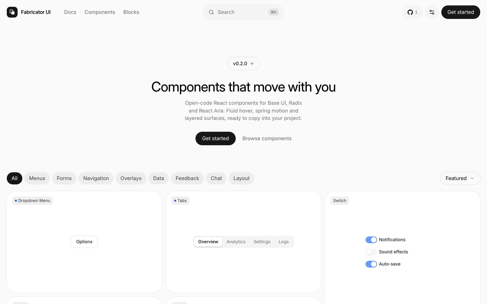

<div align="center">

<a href="https://fabricator-ui.vercel.app">
  
</a>

# Fabricator UI

**Components that move with you.**

Open-code components for React and React Native, with a design system of their own: fluid hover, layered surfaces, and motion and density you set per region. One design for web, desktop, iOS and Android, fully compatible with shadcn/ui.

**[fabricator-ui.vercel.app](https://fabricator-ui.vercel.app)**

[](https://www.npmjs.com/package/fabricator-ui)
[](https://github.com/gabrielespinheira/fabricator-ui/actions/workflows/ci.yml)
[](https://www.skills.sh/gabrielespinheira/fabricator-ui/fabricator)
[](LICENSE.md)

[Website](https://fabricator-ui.vercel.app) · [Get started](https://fabricator-ui.vercel.app/create) · [Docs](https://fabricator-ui.vercel.app/docs/installation) · [Components](https://fabricator-ui.vercel.app/docs/components) · [Icons](https://fabricator-ui.vercel.app/icons) · [Agent skill](https://www.skills.sh/gabrielespinheira/fabricator-ui/fabricator) · [Changelog](https://fabricator-ui.vercel.app/docs/changelog)

<br />

<a href="https://fabricator-ui.vercel.app">
  <picture>
    <source media="(prefers-color-scheme: dark)" srcset=".github/assets/home-dark.webp" />
    
  </picture>
</a>

</div>

## Why Fabricator UI

- **You own the code.** The CLI copies each component into your project as source. Change anything, and upgrade when you choose to.
- **One design, every platform.** The same components, names, variants and look on the web, in Electron and Tauri desktop apps, and on iOS, iPadOS and Android with React Native.
- **A design language of its own.** Fluid hover, sliding selection, layered surfaces, optional sounds and haptics. Colour, motion speed, density and corner shape are tokens you switch at runtime. See the [design guide](DESIGN.md).
- **Built for real apps.** 80+ components and 30+ blocks: forms, overlays, navigation, data display, chat and AI, video, code, file trees and an App Shell that handles phones, panels, shortcuts and desktop windows.
- **Your choice of primitives.** Every web component is written for [Base UI](https://base-ui.com) (the default), [Radix](https://www.radix-ui.com) and [React Aria](https://react-spectrum.adobe.com/react-aria/), with the same API and look in each.
- **Fabricator Icons included.** Every Lucide icon under its Lucide name, Fabricator's own icons, 145 brand marks, file and folder icons and animated icons, for React, React Native and plain SVG.
- **Accessible by default.** Keyboard and ARIA behaviour come from the primitives, every colour pair meets WCAG 2.2 AA in light and dark, and motion honours reduced-motion settings.
- **Works where you work.** Next.js, Vite, React Router, TanStack Start, Astro, Laravel and Expo, on React 19 and Tailwind CSS v4, in a single app or a monorepo.
- **Built for AI tools.** An MCP server, an agent skill, a `DESIGN.md` your agent can follow, `llms.txt` and a Markdown export of every docs page.

## Quick start

Create a project with the Fabricator look, or pick your colours, shell and framework on the [Get started page](https://fabricator-ui.vercel.app/create) and copy the command it writes:

```bash
npx fabricator-ui@latest create my-app -t next
```

Add `--mobile` for a React Native app and `--desktop electron` or `--desktop tauri` for a desktop app in the same monorepo.

Or set up an existing React or Expo project (run it in the project root):

```bash
npx fabricator-ui@latest init
```

Then add components:

```bash
npx fabricator-ui@latest add button dialog
```

```tsx
import { Button } from "@/components/ui/button"

export function Example() {
  return <Button variant="outline">Click me</Button>
}
```

Works the same with `pnpm dlx`, `yarn dlx` and `bunx --bun`. Guides per framework are in the [installation docs](https://fabricator-ui.vercel.app/docs/installation).

## CLI

| Command              | What it does                                                                     |
| -------------------- | -------------------------------------------------------------------------------- |
| `create [name]`      | Create a project or a monorepo with web, mobile and desktop apps, in one command |
| `init`               | Set up an existing project, web or React Native                                  |
| `add <items…>`       | Add components, blocks or hooks (`--all` for every component)                    |
| `upgrade [items…]`   | Reinstall your Fabricator components at their latest versions                    |
| `apply [preset]`     | Apply a Fabricator look to an existing project (`--only theme,font`)             |
| `apps add`           | Add a mobile app, or a desktop app with Electron or Tauri                        |
| `agents add`         | Set up AI assistants in the project                                              |
| `search [query]`     | Search the registry (alias `list`)                                               |
| `view <items…>`      | Print an item's files before installing                                          |
| `docs <components…>` | Show the documentation for components                                            |
| `diff <item>`        | Compare your copy with the registry version                                      |
| `doctor`             | Check that the project is ready and print a fix for each problem                 |
| `mcp`                | Run the MCP server; `mcp init --client claude` adds it to your editor            |
| `info`               | Print information about your project                                             |

Pick the primitive library with `--base base | radix | aria`. Every flag is in the [CLI reference](https://fabricator-ui.vercel.app/docs/cli).

## Already using shadcn/ui?

Fabricator UI is a drop-in for shadcn/ui projects. Components keep every upstream name, prop, variant and `data-slot`, and only add to them. Run `init` in your project and choose one of two options:

- **Add the registry only:** keep your current theme. Fabricator components use its colours, radius and fonts.
- **Apply the Fabricator theme:** switch to the Fabricator theme and reinstall your components with it.

The registry also works with the shadcn CLI directly. See [Registry](https://fabricator-ui.vercel.app/docs/registry).

## AI assistants

- **MCP:** `npx fabricator-ui@latest mcp init --client <claude|cursor|vscode|codex|opencode>` lets your assistant browse, search and install components. See [MCP](https://fabricator-ui.vercel.app/docs/mcp).
- **Agent skill:** `npx skills add gabrielespinheira/fabricator-ui` teaches your assistant how to add, compose and style Fabricator components. See [Agent Skill](https://fabricator-ui.vercel.app/docs/skills) and its [skills.sh page](https://www.skills.sh/gabrielespinheira/fabricator-ui/fabricator).
- **Design guide:** copy [`DESIGN.md`](DESIGN.md) into your project, and your agent designs screens the Fabricator way: which component fits, layout, states and patterns.
- **Docs for models:** [`llms.txt`](https://fabricator-ui.vercel.app/llms.txt), [`llms-full.txt`](https://fabricator-ui.vercel.app/llms-full.txt), and `.md` on any docs URL.

## Documentation

| Topic              | Link                                                                                                                                                                                                                                                                                                                                                                                                                                            |
| ------------------ | ----------------------------------------------------------------------------------------------------------------------------------------------------------------------------------------------------------------------------------------------------------------------------------------------------------------------------------------------------------------------------------------------------------------------------------------------- |
| Installation       | [Web frameworks](https://fabricator-ui.vercel.app/docs/installation) · [React Native](https://fabricator-ui.vercel.app/docs/installation/react-native) · [Monorepos](https://fabricator-ui.vercel.app/docs/monorepo)                                                                                                                                                                                                                            |
| Components         | [fabricator-ui.vercel.app/docs/components](https://fabricator-ui.vercel.app/docs/components)                                                                                                                                                                                                                                                                                                                                                    |
| Icons              | [Fabricator Icons](https://fabricator-ui.vercel.app/docs/icons)                                                                                                                                                                                                                                                                                                                                                                                 |
| Design foundations | [Colors](https://fabricator-ui.vercel.app/docs/foundations/colors) · [Typography](https://fabricator-ui.vercel.app/docs/foundations/typography) · [Density](https://fabricator-ui.vercel.app/docs/foundations/density) · [Motion](https://fabricator-ui.vercel.app/docs/foundations/motion) · [Fluid hover](https://fabricator-ui.vercel.app/docs/foundations/fluid-hover) · [Sounds](https://fabricator-ui.vercel.app/docs/foundations/sounds) |
| Dark mode          | [Dark mode](https://fabricator-ui.vercel.app/docs/dark-mode)                                                                                                                                                                                                                                                                                                                                                                                    |

## Repository

This monorepo holds the component registry, the CLI, Fabricator Icons, the website that documents and serves the registry, and desktop and mobile examples.

| Path                                               | What                                                                               |
| -------------------------------------------------- | ---------------------------------------------------------------------------------- |
| [`apps/web`](apps/web)                             | The website (Next.js, Fumadocs) and the registry it serves at `/r`                 |
| [`apps/web/registry`](apps/web/registry)           | Component source for each primitive library and React Native, and the styles       |
| [`apps/desktop`](apps/desktop)                     | Desktop example in Electron and Tauri                                              |
| [`apps/mobile`](apps/mobile)                       | React Native example with Expo                                                     |
| [`packages/cli`](packages/cli)                     | The [`fabricator-ui`](https://www.npmjs.com/package/fabricator-ui) CLI             |
| [`packages/icons`](packages/icons)                 | Fabricator Icons for React, with `icons-react-native` and `icons-static` beside it |
| [`packages/editor-native`](packages/editor-native) | The native text view behind the React Native editor                                |
| [`packages/tests`](packages/tests)                 | End-to-end install tests against real framework templates                          |
| [`skills/fabricator`](skills/fabricator)           | Agent skill for projects that use Fabricator UI                                    |
| [`docs`](docs)                                     | How the repository works: components, styles, platforms, registry, releases        |

## Development

Requires [Bun](https://bun.sh) 1.4 or later and Node.js 20.18.1 or later.

```bash
git clone https://github.com/gabrielespinheira/fabricator-ui.git
cd fabricator-ui
bun install
bun install --cwd apps/mobile   # once, for the tests
bun run registry:build          # once on a fresh clone
bun run dev                     # http://localhost:4000
```

`bun run check` lints, typechecks and checks formatting; `bun run test` runs the unit tests. Every other task is in [`CONTRIBUTING.md`](CONTRIBUTING.md).

## Contributing

Contributions are welcome. Read [`CONTRIBUTING.md`](CONTRIBUTING.md) for the workflow and [`AGENTS.md`](AGENTS.md) for the rules every change follows (they apply to people and coding agents alike). Details per area are in [`docs/`](docs/), with how Fabricator works across platforms in [`docs/PLATFORMS.md`](docs/PLATFORMS.md).

Found a bug or have an idea? [Open an issue](https://github.com/gabrielespinheira/fabricator-ui/issues).

## Acknowledgements

Fabricator UI is built on [shadcn/ui](https://github.com/shadcn-ui/ui) by shadcn, which is MIT licensed. See [`NOTICE.md`](NOTICE.md).

## License

[MIT](LICENSE.md)
