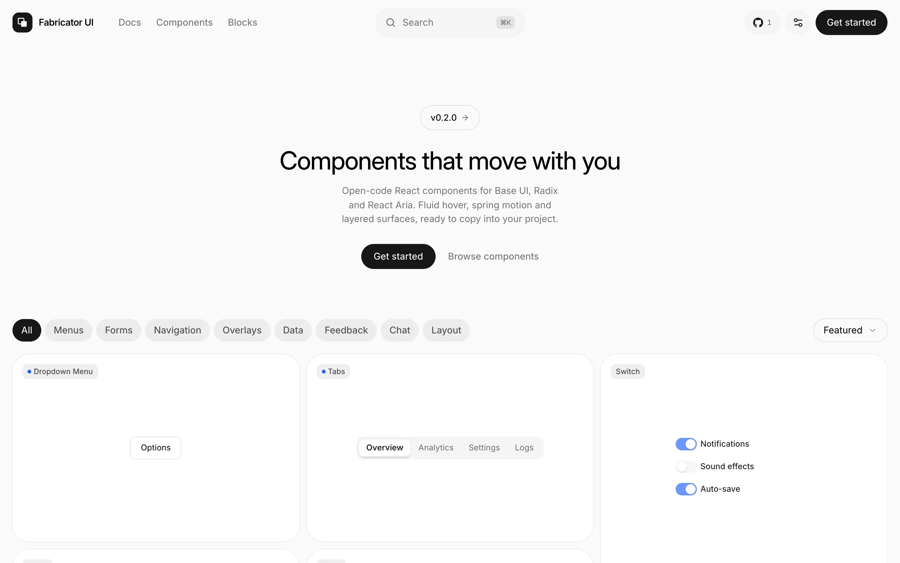

<div align="center">

<a href="https://fabricator-ui.vercel.app">
  
</a>

# Fabricator UI

**Components that move with you.**

Open-code React components for Base UI, Radix and React Aria. Fluid hover, spring motion and layered surfaces, ready to copy into your project.

[](https://www.npmjs.com/package/fabricator-ui)
[](https://github.com/gabrielespinheira/fabricator-ui/actions/workflows/ci.yml)
[](LICENSE.md)

[Website](https://fabricator-ui.vercel.app) · [Docs](https://fabricator-ui.vercel.app/docs/installation) · [Components](https://fabricator-ui.vercel.app/docs/components) · [Blocks](https://fabricator-ui.vercel.app/blocks) · [Changelog](https://fabricator-ui.vercel.app/docs/changelog)

<br />

<a href="https://fabricator-ui.vercel.app">
  <picture>
    <source media="(prefers-color-scheme: dark)" srcset=".github/assets/home-dark.webp" />
    
  </picture>
</a>

</div>

## Why Fabricator UI

- **You own the code.** The CLI copies each component into your project as source. Change anything, and upgrade only when you choose to.
- **A design language of its own.** Fluid hover, sliding selection, tiered motion tokens, layered surfaces and optional sound effects, all tuned in one [design spec](apps/web/registry/fabricator/DESIGN.md).
- **Three primitive libraries.** Every component is written for [Base UI](https://base-ui.com) (the default), [Radix](https://www.radix-ui.com) and [React Aria](https://react-spectrum.adobe.com/react-aria/), with the same API, slots and look in each.
- **60+ components and 30 blocks.** Forms, menus, overlays, navigation, data display, chat and full page layouts.
- **Accessible by default.** Keyboard and ARIA behaviour come from the primitives, every colour pair meets WCAG 2.2 AA, and motion honours `prefers-reduced-motion`.
- **Works where you work.** Next.js, Vite, React Router, TanStack Start, Astro and Laravel, on React 19 and Tailwind CSS v4.
- **Built for AI tools.** An MCP server, an agent skill, `llms.txt` and a Markdown export of every docs page.

## Quick start

Create a new app with the Fabricator look:

```bash
npx fabricator-ui@latest init -t next
```

Or set up an existing React project (run it in the project root):

```bash
npx fabricator-ui@latest init
```

Then add components:

```bash
npx fabricator-ui@latest add button dialog
```

```tsx
import { Button } from "@/components/ui/button"

export function Example() {
  return <Button variant="outline">Click me</Button>
}
```

Works the same with `pnpm dlx`, `yarn dlx` and `bunx --bun`. Full guides per framework are in the [installation docs](https://fabricator-ui.vercel.app/docs/installation).

## CLI

| Command              | What it does                                                                                      |
| -------------------- | ------------------------------------------------------------------------------------------------- |
| `init`               | Set up a new (`-t next \| vite \| start \| react-router \| astro \| laravel`) or existing project |
| `add <items…>`       | Add components, blocks or hooks (`--all` for every component)                                     |
| `apply [preset]`     | Apply a Fabricator preset to an existing project (`--only theme,font`)                            |
| `search [query]`     | Search the registry (alias `list`)                                                                |
| `view <items…>`      | Print an item's files before installing                                                           |
| `docs <components…>` | Show the documentation for components                                                             |
| `diff <item>`        | Compare your copy with the registry version                                                       |
| `doctor`             | Check that the project is ready and print a fix for each problem                                  |
| `mcp`                | Run the MCP server; `mcp init --client claude` adds it to your editor                             |
| `info`               | Print information about your project                                                              |

Pick the primitive library with `--base base | radix | aria`. Every flag is documented in the [CLI reference](https://fabricator-ui.vercel.app/docs/cli).

## Already using shadcn/ui?

Fabricator UI is a drop-in for shadcn/ui projects. Components keep every upstream name, prop, variant and `data-slot`, and only add to them. Run `init` in your project and choose one of two options:

- **Add the registry only:** keep your current theme. Fabricator components use its colours, radius and fonts.
- **Apply the Fabricator theme:** switch to the Fabricator theme and reinstall your components with it.

The registry also works with the shadcn CLI directly. See [Registry](https://fabricator-ui.vercel.app/docs/registry).

## AI assistants

- **MCP:** `npx fabricator-ui@latest mcp init --client <claude|cursor|vscode|codex|opencode>` lets your assistant browse, search and install components. See [MCP](https://fabricator-ui.vercel.app/docs/mcp).
- **Agent skill:** `npx skills add gabrielespinheira/fabricator-ui` teaches your assistant how to add, compose and style Fabricator components. See [Agent Skill](https://fabricator-ui.vercel.app/docs/skills) and [skills.sh](https://skills.sh/gabrielespinheira/fabricator-ui/fabricator).
- **Docs for models:** [`llms.txt`](https://fabricator-ui.vercel.app/llms.txt), [`llms-full.txt`](https://fabricator-ui.vercel.app/llms-full.txt), and `.md` on any docs URL.

## Documentation

| Topic              | Link                                                                                                                                                                                                                       |
| ------------------ | -------------------------------------------------------------------------------------------------------------------------------------------------------------------------------------------------------------------------- |
| Installation       | [fabricator-ui.vercel.app/docs/installation](https://fabricator-ui.vercel.app/docs/installation)                                                                                                                           |
| Components         | [fabricator-ui.vercel.app/docs/components](https://fabricator-ui.vercel.app/docs/components)                                                                                                                               |
| Dark mode          | [Dark mode](https://fabricator-ui.vercel.app/docs/dark-mode)                                                                                                                                                               |
| Design foundations | [Colors](https://fabricator-ui.vercel.app/docs/foundations/colors) · [Motion](https://fabricator-ui.vercel.app/docs/foundations/motion) · [Fluid hover](https://fabricator-ui.vercel.app/docs/foundations/fluid-hover) |
| Monorepos          | [fabricator-ui.vercel.app/docs/monorepo](https://fabricator-ui.vercel.app/docs/monorepo)                                                                                                                                   |

## Repository

This monorepo holds the component registry, the CLI and the website that documents and serves the registry.

| Path                                                           | What                                                                   |
| -------------------------------------------------------------- | ---------------------------------------------------------------------- |
| [`apps/web`](apps/web)                                         | The website (Next.js, Fumadocs) and the registry it serves at `/r`     |
| [`apps/web/registry/bases`](apps/web/registry/bases)           | Component source for each primitive library (`base`, `radix`, `aria`)  |
| [`apps/web/registry/styles`](apps/web/registry/styles)         | Style maps, including the Fabricator style                             |
| [`apps/web/registry/fabricator`](apps/web/registry/fabricator) | Design tokens, the design spec and Fabricator-only behaviour           |
| [`packages/cli`](packages/cli)                                 | The [`fabricator-ui`](https://www.npmjs.com/package/fabricator-ui) CLI |
| [`packages/tests`](packages/tests)                             | End-to-end install tests against real framework templates              |
| [`skills/fabricator`](skills/fabricator)                       | Agent skill for projects that use Fabricator UI                        |

## Development

Requires [Bun](https://bun.sh) 1.4 or later and Node.js 20.18.1 or later.

```bash
git clone https://github.com/gabrielespinheira/fabricator-ui.git
cd fabricator-ui
bun install
bun run registry:build   # once on a fresh clone
bun run dev              # http://localhost:4000
```

| Task                                                     | Command                                                                         |
| -------------------------------------------------------- | ------------------------------------------------------------------------------- |
| Lint, typecheck and format check                         | `bun run check`                                                                 |
| Unit tests                                               | `bun run test`                                                                  |
| Full registry build (before committing registry changes) | `bun run registry:build`                                                        |
| Compare output with upstream shadcn/ui                   | `bun run test:parity`                                                           |
| CLI end-to-end tests (dev server running)                | `bun run test:e2e`                                                              |
| Run the local CLI against the local registry             | `FABRICATOR_REGISTRY_URL=http://localhost:4000 bun run cli add button -c <app>` |
| Add a release note                                       | `bunx changeset`                                                                |

## Contributing

Contributions are welcome. Read [`CONTRIBUTING.md`](CONTRIBUTING.md) for the workflow and [`AGENTS.md`](AGENTS.md) for the rules every change follows (they apply to people and coding agents alike). Architecture and roadmap are in [`PLAN.md`](PLAN.md).

Found a bug or have an idea? [Open an issue](https://github.com/gabrielespinheira/fabricator-ui/issues).

## Acknowledgements

Fabricator UI is built on [shadcn/ui](https://github.com/shadcn-ui/ui) by shadcn, and its design language adapts [Fluid Functionalism](https://github.com/mickadesign/fluid-functionalism). Both are MIT licensed. See [`NOTICE.md`](NOTICE.md).

## License

[MIT](LICENSE.md)
